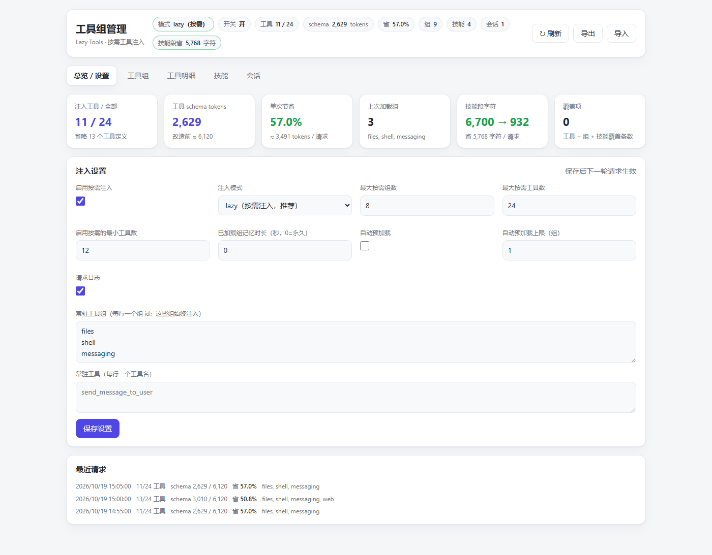
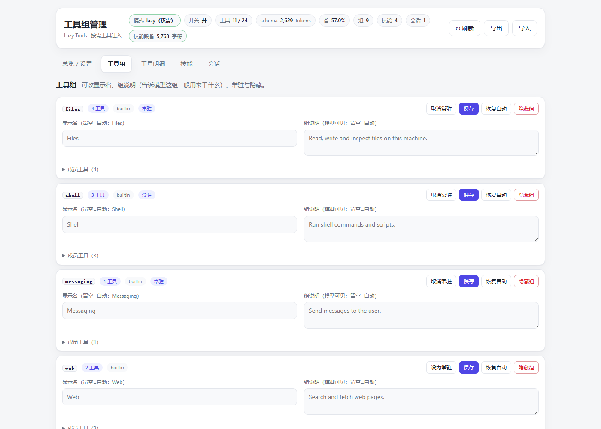
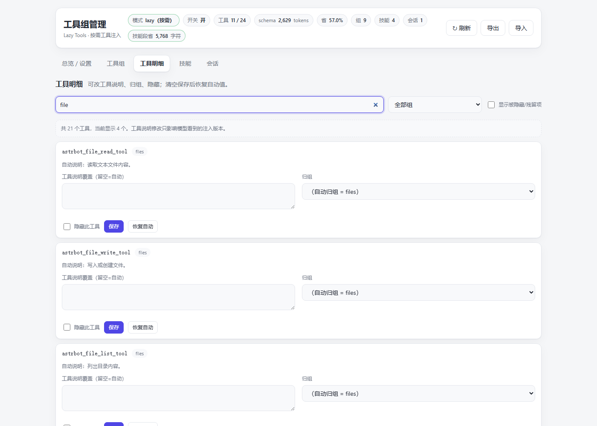
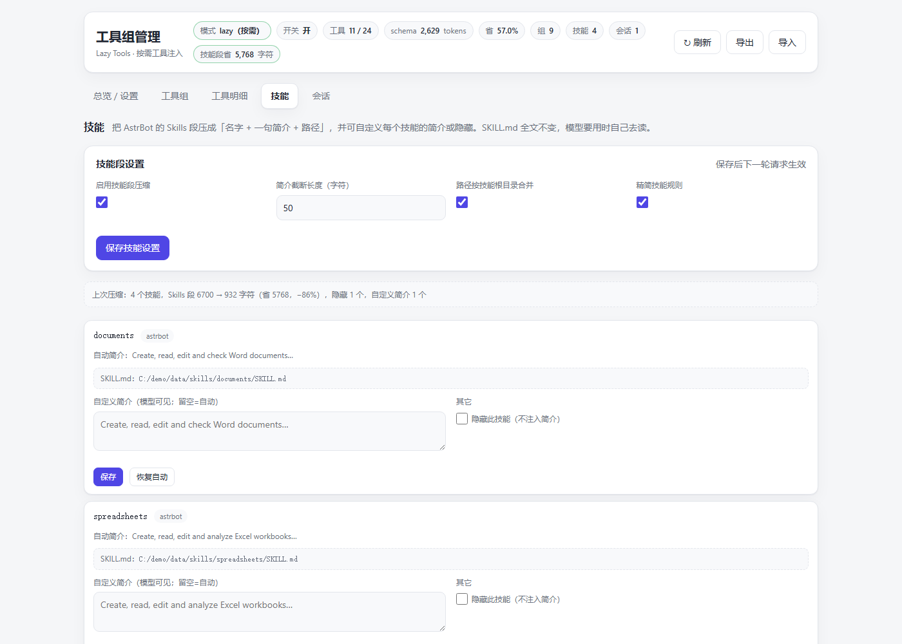

# astrbot_plugin_lazy_tools

**工具按需注入（Lazy Tools）· 一个把 AstrBot 工具 schema 改成“按需下发”的插件**


> [!IMPORTANT]
> **声明：本仓库的代码、文档与截图示例由大模型（DeepSeek）辅助生成**，随后经过人工审查、单元测试与真实 AstrBot 实例联调验证。使用前请自行审阅代码，生产环境请先在测试实例验证。

---

## 它解决什么问题

AstrBot 默认会在**每一次** LLM 请求里带上**全部工具**的定义（插件、MCP、内置能力加起来很容易到 100+ 个）。
这带来两个问题：

1. **token 浪费**：工具 schema 动辄 1~3 万 token，而且 cached token 也是要计费的；
2. **缓存前缀不稳**：工具块一变，从该位置往后的前缀缓存全部失效。

本插件把注入改成“两段式”：

```
改造前:  system prompt + [全部工具 schema] + 历史消息
改造后:  system prompt + [3 个元工具 + 常驻工具 + 本会话已加载工具] + 历史消息
          ↑ 其余工具按「内置能力 / 插件 / MCP server」自动分组隐藏
          ↑ 模型需要时先搜索、再加载，下一步直接可用
```

工具块顺序确定、已加载组 sticky（会话内保留 + 持久化到磁盘），同一会话后续轮次工具块稳定，方便前缀缓存。

**示例收益**（工具越多越明显）：24 个工具的演示数据里，默认只注入 11 个，schema 估算 6,120 → 2,629 tokens（−57%）；100+ 工具的真实实例里可到 −87%。

同一插件也接管 AstrBot 的 `## Skills` 段：原本每轮都是「技能名 + 完整 description + 绝对路径 + 七条英文规则」，现在压成「技能名 + 一句简介 + 路径」（同一根目录只写一次）+ 两行中文规则。实测 5 个技能时 **6,700 → 932 字符（−86%）**；技能全文仍然留在各自的 `SKILL.md`，模型真要用时才去读。

---

## 功能

- **三个元工具**
  - `astrbot_find_tools`：列组 / 搜索工具 / 查看某组工具
  - `astrbot_load_tools`：按组或按工具加载，下一步直接可用
  - `astrbot_unload_tools`：卸载不再需要的组/工具
- **自动分组**：内置能力组（files / shell / web / knowledge / messaging / tasks / memory / sessions / subagents 等）、每个插件一组、每个 MCP server 一组、来源不明时按名字兜底
- **技能段按需压缩**：把 AstrBot 的 Skills 段压成「名字 + 一句简介 + 路径」，支持**自定义每个技能的简介**、隐藏技能、调整截断长度 / 是否合并根目录 / 是否精简规则；SKILL.md 全文不变
- **管理页**（插件详情 → 页面 → 工具组管理）
  - 总览：开关、lazy/full 模式、常驻组/工具、上限、记忆 TTL、自动预加载、请求日志、最近请求统计、导入导出
  - 工具组：编辑**组显示名**、**组说明**（模型可见，用来告诉它这组一般干什么）、常驻、隐藏、恢复自动
  - 工具明细：搜索过滤、编辑**每个工具的说明**、**重新归组**（可新建自定义组）、隐藏、恢复自动
  - 技能：技能段压缩参数、逐个技能自定义简介 / 隐藏、上次压缩统计
  - 会话：查看每个会话已加载的组、一键清空记忆、重置覆盖项
- **聊天命令**：`/lazy status|groups|skills|on|off|pin|unpin|desc|tooldesc|skilldesc|skillhide|skillshow|skillreset|reset`
- **数据持久化**：注入参数、覆盖项、会话状态分别保存在插件数据目录，重启/重载不丢
- **无第三方依赖**

---

## 截图

**总览 / 设置**



**工具组**（组显示名、组说明、常驻、隐藏）



**工具明细**（工具说明覆盖、归组、隐藏）



**技能**（技能段压缩设置、自定义技能简介、隐藏技能）



> 截图使用脱敏的模拟数据生成，不包含任何真实环境信息。

---

## 安装

要求：AstrBot **>= 4.25.5**（需要插件页面 / Plugin Page Bridge 能力），无第三方 Python 依赖。

### 方式一：手动安装（推荐）

1. 下载本仓库源码（或 Releases 里的 zip）；
2. 把 `astrbot_plugin_lazy_tools/` 整个目录放到 AstrBot 的 `data/plugins/` 下；
3. 重启 AstrBot，或在 WebUI 插件管理里重载插件；
4. 打开 **插件 → 工具按需注入 (Lazy Tools) → 页面 → 工具组管理** 调整配置。

### 方式二：插件市场

如果之后上架 AstrBot 插件市场，可直接在插件页搜索安装。

### 升级

插件在 `data/plugins/` 下，升级 AstrBot 核心不会覆盖；更新插件时替换目录后重载即可。

### 卸载

在插件管理里停用或删除插件，立即恢复 AstrBot 原生「全量工具注入」；也可以先在管理页把模式切到 `full` / 关闭开关做软关闭。

---

## 配置

- 插件配置页只有一个总开关 `enabled`（关闭 = 完全恢复原生行为）。
- 其余参数在管理页编辑，保存在 `data/plugin_data/astrbot_plugin_lazy_tools/`：

| 文件 | 内容 |
| --- | --- |
| `config.json` | 注入参数（模式、常驻组、上限、TTL、自动预加载、日志、技能段压缩参数） |
| `overrides.json` | 组/工具的说明、归组、隐藏、技能简介/隐藏等覆盖项 |
| `state.json` | 各会话已加载的组 + 最近请求统计（重启后保留） |

删除这些文件即可恢复默认。管理页也支持导入/导出 JSON。

---

## 命令

| 命令 | 说明 |
| --- | --- |
| `/lazy` | 查看状态（模式、常驻组、上次注入统计、会话数） |
| `/lazy groups` | 列出工具组与说明 |
| `/lazy skills` | 列出技能、简介与上次压缩统计 |
| `/lazy on` / `/lazy off` | 开关按需注入（管理员） |
| `/lazy pin <组id>` / `/lazy unpin <组id>` | 常驻 / 取消常驻（管理员） |
| `/lazy desc <组id> <说明>` | 设置组说明（管理员） |
| `/lazy tooldesc <工具名> <说明>` | 设置工具说明（管理员） |
| `/lazy skilldesc <技能名> <说明>` | 自定义技能简介（管理员） |
| `/lazy skillhide <技能名>` / `/lazy skillshow <技能名>` | 隐藏 / 恢复技能（管理员） |
| `/lazy skillreset <技能名>` | 恢复技能自动简介（管理员） |
| `/lazy reset` | 清空所有会话的已加载组记忆（管理员） |

---

## 设计说明与缓存

- **分组是确定性的**：同一组工具集合、同一顺序渲染，跨轮字节稳定；
- **已加载组 sticky**：加载一次后本会话后续轮次保留，并持久化到 `state.json`；
- **自动预加载默认关闭**：关键词启发式容易误判，误加载反而破坏缓存、浪费 token；需要时再开启（只认组名/组 id 强信号）；
- **工具说明覆盖**通过复制工具对象实现，不修改全局工具定义，也不影响权限校验；
- **技能简介覆盖**只替换注入到 system prompt 的那一行简介，不修改 SKILL.md 文件，也不影响技能目录；
- **技能压缩失败安全**：解析不到 `## Skills` 段或结构不认识时原样放行，不会把技能弄丢；
- 与 AstrBot 的 `tool_schema_mode=skills_like` **不兼容**，请使用 `full`（插件会打 warning）。

更详细的设计、缓存命中实测与权衡见 [docs/DESIGN.md](docs/DESIGN.md)。

---

## 兼容性 / 已知限制

- 需要 AstrBot >= 4.25.5（插件页面 SDK）。
- 与 `tool_schema_mode=skills_like` 不兼容。
- 模型如果直接调用未加载的工具，会拿到 AstrBot 原生的“工具不存在 + 可用工具列表”错误，再自行搜索/加载；插件没有修改核心，所以没有“自动补加载”的自愈。
- 一次 Agent 运行内工具目录是快照；运行中新注册的工具在下一轮用户消息进入目录。
- 技能段压缩只作用于注入的 system prompt，`tool_schema_mode` 与技能系统本身的行为不受影响。
- 自动预加载是启发式功能，默认关闭。

---

## 隐私

- 插件**不收集、不上报**任何用户数据；所有配置和状态只写入本机 AstrBot 的 `data/plugin_data/`。
- 管理页通过 AstrBot Dashboard 自带的鉴权与 Plugin Page Bridge 访问，不额外暴露端口。
- 本仓库的截图使用模拟数据生成，不包含作者或第三方的真实环境信息。

## License

[MIT](LICENSE)

## 致谢

- [AstrBot](https://github.com/AstrBotDevs/AstrBot)：插件运行平台与 Plugin Page / Bridge SDK。
- 欢迎 Issue / PR 反馈 bug 或改进建议。
